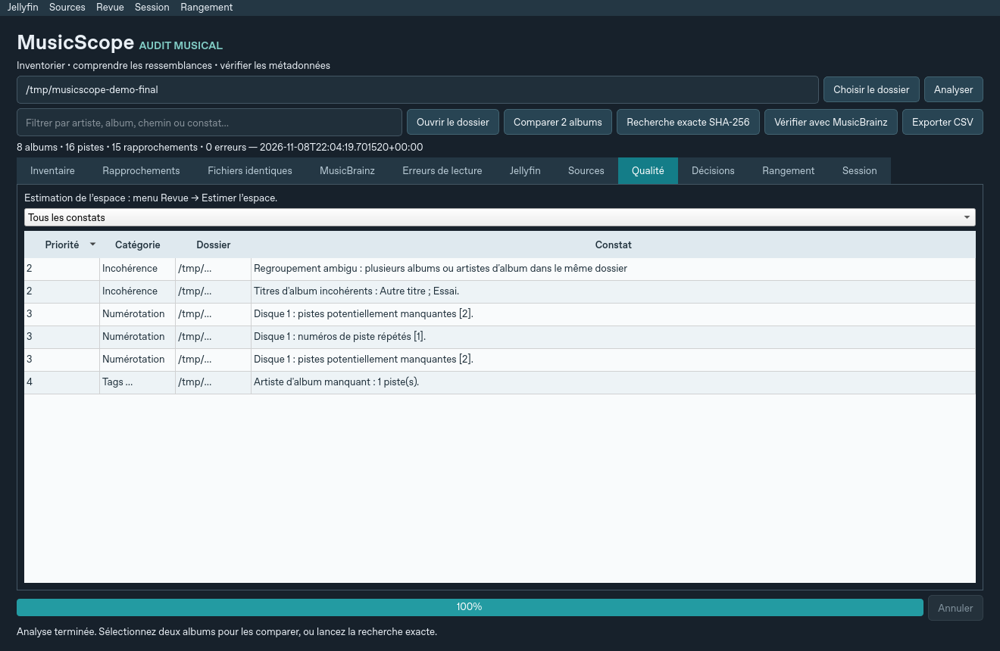

# MusicScope

MusicScope est une application de bureau en français pour inventorier une médiathèque musicale, comparer des albums et vérifier leurs métadonnées avec MusicBrainz. Elle aide à comprendre les ressemblances avant de décider quoi conserver.

La version **0.3** utilise Python 3.12, PySide6/Qt Widgets, Mutagen et SQLite. Le scan et les diagnostics consultent les fichiers audio en lecture seule. Le rangement est une opération séparée : une prévisualisation, une confirmation manuelle et un journal sont requis avant de renommer un dossier. Aucun effacement ni changement de tags n'est proposé.



## Installation et lancement

Un environnement graphique est nécessaire pour l'interface. Le scan en ligne de commande fonctionne sans écran. Le scan ne nécessite ni FFmpeg, ni serveur Jellyfin, ni clé API. Les intégrations facultatives sont détaillées ci-dessous.

### Exécutables Arch Linux et Debian, sans installation de Python

Consultez les [versions GitHub](https://github.com/1002-AZ-2001/MusicScope/releases). La distribution cible pour le moment **Debian et Arch Linux en x86-64** : paquet `.deb`, paquet Arch `.pkg.tar.zst` et archive Linux autonome. Le workflow les publie après leurs tests. Pour l'archive, extrayez **tout le dossier** avant de lancer `MusicScope` ; ne déplacez pas le binaire seul. La distribution Windows est reportée.

La [version v0.3.0](https://github.com/1002-AZ-2001/MusicScope/releases/tag/v0.3.0) accélère le scan des grandes bibliothèques ; la [version v0.2.1](https://github.com/1002-AZ-2001/MusicScope/releases/tag/v0.2.1) reste disponible. Vérifier les fichiers attachés à chaque version avant installation.

```bash
# Debian 12 ou ultérieure, après téléchargement du .deb
sudo apt install ./musicscope_0.3.0-1_amd64.deb
# Arch Linux, après téléchargement du paquet Arch
sudo pacman -U ./musicscope-0.3.0-1-x86_64.pkg.tar.zst
# Lancer l'application après installation
musicscope
```

Les commandes de construction, les sommes de contrôle et les prérequis graphiques figurent dans le [guide de distribution](docs/distribution.md). La présence du workflow dans le dépôt ne prouve pas à elle seule qu'une version binaire a été construite : vérifier les fichiers attachés à la version.

### Windows — PowerShell

Depuis la racine du dépôt, avec Python 3.12 installé :

```powershell
py -3.12 -m venv .venv
.\.venv\Scripts\python.exe -m pip install -e ".[test]"
.\.venv\Scripts\python.exe -m musicscope
```

Ces commandes n'exigent pas l'activation PowerShell du venv. Un chemin UNC, par exemple `\\truenas\Musique`, peut être choisi dans la boîte de sélection de dossier. Le partage doit déjà être accessible avec les droits de votre session Windows ; MusicScope ne gère pas les identifiants SMB.

### Linux

Depuis la racine du dépôt, avec Python 3.12 et son module `venv` installés :

```bash
python3.12 -m venv .venv
.venv/bin/python -m pip install -e '.[test]'
.venv/bin/python -m musicscope
```

Choisissez un dossier local ou un partage NFS/SMB déjà monté, par exemple `/mnt/Musique`. Sur une installation minimale, Qt peut nécessiter les bibliothèques graphiques de la distribution, notamment EGL/OpenGL et XCB. Consultez les messages Qt si le chargement du greffon graphique échoue.

### Installation verrouillée avec uv

Le fichier `uv.lock` conserve les versions résolues. Si `uv` est disponible, il peut remplacer les étapes de création du venv et d'installation :

```bash
uv sync --python 3.12 --locked --extra test
uv run --no-sync python -m musicscope
```

Pour les synchronisations suivantes dans un environnement Python déjà sélectionné : `uv sync --locked --extra test`.

## Essayer sans votre médiathèque

Créez un dossier de démonstration vide ou inexistant :

```bash
# Linux
.venv/bin/python -m musicscope --demo ./demo-library
.venv/bin/python -m musicscope
```

```powershell
# PowerShell
.\.venv\Scripts\python.exe -m musicscope --demo .\demo-library
.\.venv\Scripts\python.exe -m musicscope
```

Dans l'interface, choisissez `demo-library`. Le corpus contient des sons synthétiques FLAC et MP3, des copies aux noms différents, une variante avec piste bonus, un album incomplet, un album multidisque et des tags incohérents. Des liens physiques sont créés si la destination les autorise. Le dossier de démonstration ne contient pas d'identifiants d'éditions réelles : il sert surtout à essayer l'audit local.

Les petits fichiers audio de référence sont inclus dans le paquet. FFmpeg a servi à leur génération pendant le développement ; il n'est pas utilisé lors de la création de la démonstration.

## Parcours dans l'interface

1. **Choisir le dossier** lance l'inventaire. **Analyser** l'actualise ensuite. Le parcours et la lecture des fichiers tournent en arrière-plan ; la progression, l'annulation et les erreurs sont visibles.
2. Dans **Inventaire**, triez les colonnes ou utilisez le filtre. Sélectionnez un album pour consulter ses pistes et tags actuels. **Ouvrir le dossier** ouvre l'explorateur du système.
3. Dans **Rapprochements**, consultez les candidats trouvés par identifiants MusicBrainz ou par artiste d'album/titre normalisés. Le détail présente les deux albums côte à côte et les raisons du statut.
4. Pour une comparaison manuelle, sélectionnez exactement deux albums dans l'inventaire avec **Ctrl + clic**, puis **Comparer 2 albums**. Cette opération peut calculer les SHA-256 si les tailles concordent.
5. **Recherche exacte SHA-256** recherche les fichiers identiques dans tout l'inventaire, indépendamment de leurs noms. Les fichiers sont préfiltrés par taille, puis hachés en flux. Un groupe de fichiers identiques ne prouve pas qu'un album entier est un doublon.
6. Sélectionnez un seul album, puis **Vérifier avec MusicBrainz**. Les éditions candidates, leurs liens, les motifs d'écart et les propositions de tags sont affichés. Les propositions ne sont jamais appliquées.
7. **Exporter CSV** enregistre l'inventaire et les constats disponibles, y compris les comparaisons, erreurs et vérifications MusicBrainz exécutées pendant la session.

Le filtre concerne les tableaux d'inventaire et de rapprochements. L'export couvre les constats de la session, même lorsqu'un filtre masque certaines lignes. Les résultats de comparaison et MusicBrainz affichés dans l'interface sont réinitialisés après un nouveau scan ; exportez-les si vous souhaitez conserver ces constats.

## Fonctions de la feuille de route

Les menus donnent accès aux onglets supplémentaires :

- **Jellyfin** : renseigner l'adresse du serveur et sa clé API dans l'application, puis définir chaque préfixe serveur et son dossier local correspondant. Le catalogue et les fichiers réels restent distincts. Un chemin non résolu ou un catalogue interrompu ne devient pas une preuve d'absence.
- **Sources audio** : produire l'empreinte d'une piste avec Chromaprint, puis chercher ses enregistrements avec AcoustID ; consulter et comparer les pochettes de deux éditions ; rechercher les alias MusicBrainz d'un artiste. Chaque source et son lien restent visibles. Aucun résultat ne réécrit les tags.
- **Qualité et espace** : filtrer les constats par catégorie et commencer par les erreurs de lecture ou albums incomplets. Les estimations comptent une seule fois les identités physiques fiables et restent indéterminées si le partage ne permet pas de les vérifier. Une recherche exacte affiche son coût avant de lire les fichiers.
- **Décisions** : sélectionner deux albums et enregistrer « Conserver les deux », « À revoir » ou « Faux positif », avec une note. Les décisions sont datées et deviennent anciennes quand les fichiers ou les preuves changent.
- **Session** : exporter ou réimporter un JSON versionné, en définissant une correspondance de chemins si vous changez de poste. Les preuves importées restent historiques ; analyser les sources à nouveau avant toute action sur les fichiers.
- **Rangement** : choisir un album et une racine de destination pour prévisualiser `Artiste/Album (année)`. Vérifier le plan, puis confirmer l'application ; les liens physiques demandent un accord distinct. Les volumes différents, collisions, liens symboliques, modifications concurrentes détectées et albums imbriqués hors périmètre sont refusés. Restaurer avec le journal conservé dans le cache. Ne pas modifier les fichiers entre le rangement et sa restauration.

### Composants facultatifs et accès distants

L'empreinte audio nécessite le programme officiel **fpcalc**, disponible depuis [Chromaprint](https://acoustid.org/chromaprint). Sous Debian/Ubuntu, le paquet est `libchromaprint-tools`. Sous Windows, placer `fpcalc.exe` à côté de `MusicScope.exe`, ou ajouter son dossier au `PATH`. Sous Linux, `fpcalc` peut également être placé à côté du binaire. Il n'est pas redistribué dans nos archives ; les autres fonctions restent utilisables sans lui.

AcoustID nécessite une **clé d'application**, à obtenir auprès d'[AcoustID](https://acoustid.org/api-key). La clé Jellyfin et la clé AcoustID sont saisies dans l'application et conservées en mémoire seulement : ne les mettre ni dans les exports ni dans le dépôt.

Pour un environnement réseau restreint, autoriser les destinations nécessaires : votre serveur Jellyfin, `musicbrainz.org`, `api.acoustid.org`, `coverartarchive.org`, `archive.org` et les sous-domaines Archive.org servant les images. Le scan reste disponible hors ligne. Les erreurs de service sont distinguées d'une absence de résultat.

## Comprendre les statuts

| Statut | Ce qui a été observé |
| --- | --- |
| **Même fichier physique** | Chaque piste des deux inventaires complets correspond à la même identité de fichier sur le même volume. Les identités disponibles sont revérifiées avant la conclusion. |
| **Fichiers identiques octet pour octet** | Les SHA-256 correspondent une à une pour tous les fichiers des deux inventaires complets. |
| **Même édition probable** | Le MBID d'édition est commun et les disques, positions, titres, durées et identifiants d'enregistrement renseignés concordent. |
| **Pistes correspondantes, édition à vérifier** | Les listes de pistes concordent, par exemple en FLAC et MP3, sans preuve suffisante sur l'édition. Cela ne prouve pas une identité audio. |
| **Éditions distinctes** | Les tags cohérents portent des MBID d'édition différents. Les différences de pistes restent visibles ; une consultation MusicBrainz aide à confirmer les éditions. |
| **À vérifier** | L'inventaire, les tags ou les preuves sont incomplets, ambigus ou contradictoires. |

La tolérance de comparaison des durées est de deux secondes. Les mentions Deluxe, Live, Remaster ou bonus restent visibles ; elles peuvent élargir la recherche des candidats sans constituer une preuve d'égalité.

L'identité physique est exploitée de façon conservatrice sur les systèmes locaux reconnus sous Linux et sur les volumes locaux NTFS/ReFS vérifiables sous Windows. Elle reste **indisponible sur les partages NFS/SMB/FUSE, les chemins UNC et les volumes non vérifiables**. La recherche SHA-256 reste utilisable. La détection Windows est couverte par des tests de sondes simulées, mais reste à valider sur un poste Windows réel. Deux chemins vers un lien physique ne représentent pas deux copies complètes d'espace disque à récupérer.

## Sources, cache et fonctionnement hors ligne

Les formats lus sont FLAC, MP3, M4A, Ogg Vorbis et Opus. Les tags distinguent artiste d'album et artiste de piste, date d'édition et date originale, ainsi que les identifiants MusicBrainz d'artiste, d'édition, de groupe d'éditions et d'enregistrement disponibles.

Chaque dossier d'album reste distinct. Les sous-dossiers reconnus comme `CD1`, `Disc 02` ou `Disque 2` sont rattachés au dossier parent ; les regroupements ambigus sont signalés. Les liens symboliques et jonctions sont ignorés.

Les lectures de tags et les SHA-256 sont mis en cache par chemin, taille et date de modification. Un scan annulé ou un parcours inaccessible ne remplace pas le dernier inventaire complet. Par prudence, une racine soudainement vide alors qu'un inventaire non vide existe est également refusée : vérifiez alors le montage du partage. Un fichier audio invalide est signalé et rend son album incomplet.

Emplacement du cache par défaut :

- Windows : `%LOCALAPPDATA%\MusicScope` ; repli sur `~/.cache/MusicScope` si cette variable est absente.
- Linux : `$XDG_CACHE_HOME/MusicScope`, ou `~/.cache/MusicScope`.

Utilisez `--cache CHEMIN` pour choisir un autre emplacement local, **hors de la médiathèque**. Il contient l'inventaire SQLite, les hachages, le cache MusicBrainz et la dernière racine sélectionnée. Aucun secret n'y est requis. Un inventaire restauré décrit le dernier scan ; relancez l'analyse avant de prendre une décision sur des fichiers modifiés depuis.

Le scan local fonctionne hors ligne. MusicBrainz utilise HTTPS vers `musicbrainz.org`, un User-Agent identifiant MusicScope, une file limitée à une requête par seconde, un cache de sept jours et au maximum trois tentatives par requête en cas d'erreur temporaire. Le délai réseau est de vingt secondes par tentative. Cette opération n'est pas annulable depuis l'interface ; attendez sa fin avant de fermer la fenêtre.

Le MBID d'édition local est consulté en premier. S'il est absent ou incohérent, une recherche artiste/titre examine au plus cinq éditions. Plusieurs éditions plausibles, ou une recherche tronquée, laissent l'édition indéterminée. **Aucun résultat** et **Service indisponible** sont des résultats différents.

Dans l'environnement cloud de développement utilisé pour cette livraison, le proxy a refusé la connexion réelle à MusicBrainz avec une réponse 403. Autorisez le domaine `musicbrainz.org` dans les paramètres réseau de cet environnement pour essayer le service réel. Les tests HTTP simulés ne nécessitent pas cette autorisation.

## Ligne de commande et tests

Le scan JSON permet d'utiliser le moteur sans l'interface :

```bash
.venv/bin/python -m musicscope --cache /tmp/musicscope-cache --scan /mnt/Musique > inventaire.json
QT_QPA_PLATFORM=offscreen .venv/bin/python -m pytest -q
```

```powershell
.\.venv\Scripts\python.exe -m musicscope --cache "$env:LOCALAPPDATA\MusicScope" --scan '\\truenas\Musique' > inventaire.json
$env:QT_QPA_PLATFORM = 'offscreen'
.\.venv\Scripts\python.exe -m pytest -q
```

Les tests couvrent le scan, le cache et sa conservation, les copies renommées, les liens physiques lorsque disponibles, FLAC/MP3, les variantes avec bonus, les multidisques, les albums incomplets, les tags incohérents et les réponses MusicBrainz ambiguës ou indisponibles. Les appels HTTP sont simulés. Les tests d'interface utilisent Qt sans écran.

La validation locale est effectuée **sous Linux, avec Python 3.12 et Qt en mode `offscreen`**. Les essais en conteneurs Debian et Arch sont distingués des simulations dans les tests. Un véritable partage TrueNAS/NFS/SMB et les services distants réels restent à essayer avec vos accès.

### Mesurer le scan sur votre stockage

Le test de charge génère sa propre bibliothèque FLAC synthétique ; il refuse un dossier qui contient déjà des fichiers et n'ouvre jamais votre médiathèque. Pour mesurer un partage NAS, indiquez un dossier **vide** sur ce partage :

```bash
.venv/bin/python scripts/benchmark_scan.py --albums 1000 --tracks 12 --library /mnt/nas/musicscope-essai --json mesure.json
```

Le rapport donne la durée du scan à froid et à chaud, le débit en pistes par seconde, la comparaison des candidats, la mémoire maximale et le nombre de lectures de la table des montages. Le dossier généré et le cache temporaire sont supprimés à la fin, sauf avec `--keep`.

Voir les [commandes et résultats de validation](docs/validation.md). L'exécutable propose aussi `--self-test` : le moteur et l'interface Qt sont vérifiés sur un corpus temporaire, sans réseau ni médiathèque privée.

## Développement et suite

Le moteur fonctionne sans Qt. Consultez [l'architecture](docs/architecture.md) pour les modules et les garanties de lecture seule, et [la feuille de route](docs/roadmap.md) pour les évolutions proposées : diagnostic Jellyfin, empreintes audio, pochettes et rangement assisté avec journal de restauration.

Les [instructions cloud](docs/cloud-start.md) et le script `scripts/cloud-install.sh` décrivent la réinstallation dans cet environnement. La sauvegarde automatique de la configuration cloud n'a pas pu être confirmée par la plateforme.

La normalisation Unicode de `name_key` reprend l'approche du script `detecter_doublons_artistes.py` fourni avec la demande : normalisation des largeurs et accents latins, tout en préservant notamment la différence entre `カ` et `ガ`. Le script `gestionnaire_musique.py` a servi de référence fonctionnelle ; ses fonctions de renommage et de suppression ne sont pas intégrées à cette version en lecture seule.

Licence du dépôt : [GNU AGPLv3](LICENSE).

Références : [organisation musicale Jellyfin](https://jellyfin.org/docs/general/server/media/music/), [API MusicBrainz](https://musicbrainz.org/doc/MusicBrainz_API), [limites de requêtes](https://musicbrainz.org/doc/MusicBrainz_API/Rate_Limiting), [correspondance des tags Picard](https://picard-docs.musicbrainz.org/en/latest/appendices/tag_mapping.html), [Mutagen](https://mutagen.readthedocs.io/en/latest/), [Qt pour Python](https://doc.qt.io/qtforpython-6/gettingstarted.html).
