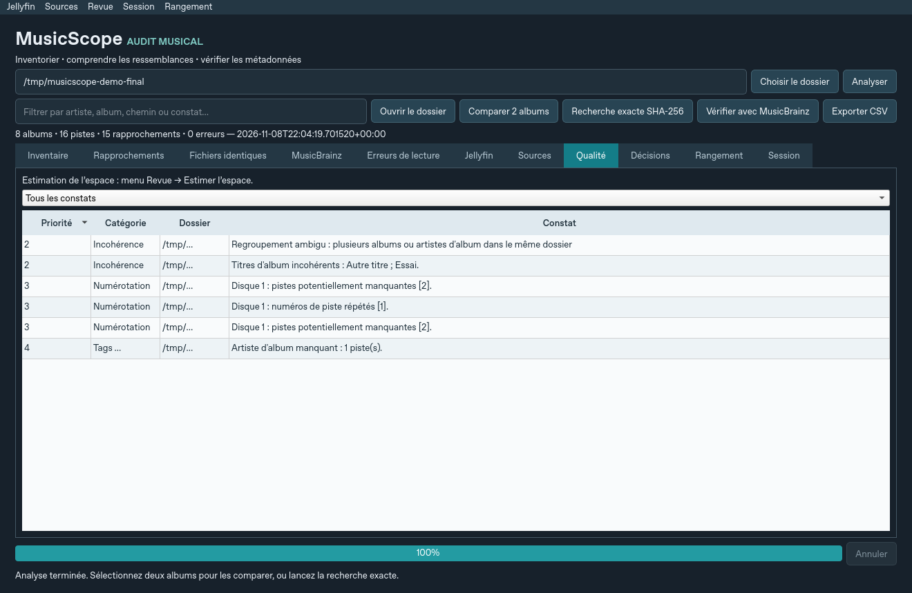

# MusicScope

MusicScope est une application de bureau en français pour inventorier une médiathèque musicale, comparer des albums et vérifier leurs métadonnées avec MusicBrainz. Elle aide à comprendre les ressemblances avant de décider quoi conserver.

La version **0.10** utilise Python 3.12, PySide6/Qt Widgets, Mutagen et SQLite. Le scan et les diagnostics consultent les fichiers audio en lecture seule. Trois opérations séparées modifient la médiathèque, toujours après un aperçu, une confirmation manuelle et un journal restaurable : le **rangement** renomme un dossier, la **quarantaine des doublons** met de côté les albums en double, l'**éditeur de tags** modifie les tags d'un album. Aucun fichier n'est effacé.



## Installation et lancement

Un environnement graphique est nécessaire pour l'interface. Le scan en ligne de commande fonctionne sans écran. Le scan ne nécessite ni FFmpeg, ni serveur Jellyfin, ni clé API. Les intégrations facultatives sont détaillées ci-dessous.

### Exécutables Arch Linux et Debian, sans installation de Python

Consultez les [versions GitHub](https://github.com/1002-AZ-2001/MusicScope/releases). La distribution cible pour le moment **Debian et Arch Linux en x86-64** : paquet `.deb`, paquet Arch `.pkg.tar.zst` et archive Linux autonome. Le workflow les publie après leurs tests. Pour l'archive, extrayez **tout le dossier** avant de lancer `MusicScope` ; ne déplacez pas le binaire seul. La distribution Windows est reportée.

La [version v0.21.0](https://github.com/1002-AZ-2001/MusicScope/releases/tag/v0.21.0) identifie plusieurs albums sur MusicBrainz et n’en écrit que les identifiants, pour les seuls albums dont l’édition est sûre ; la v0.20.0 modifie les tags de plusieurs albums d’un coup (valeurs communes, champs vidés, rechercher / remplacer), avec aperçu et annulation en une fois ; la v0.19.0 peut garder les clés Lidarr, Jellyfin, qBittorrent et AcoustID dans le trousseau du système, sur demande ; la v0.18.1 publie aussi l’image du NAS et réessaie les attestations Sigstore quand le service est lent ; la v0.18.0 se met à jour elle-même : une fois par jour, elle signale une nouvelle version et l’installe sur demande, après avoir vérifié son origine et son SHA-256 ; la v0.17.0 fait le travail lourd directement sur le NAS (TrueNAS SCALE ou tout hôte Docker) : un conteneur en lecture seule, sans réseau, lit les tags, calcule les SHA-256 et le spectre des FLAC, puis le poste importe le résultat et ne relit plus que les fichiers modifiés ; la v0.16.0 prévient Lidarr et Jellyfin après un rangement, une quarantaine ou une écriture de tags, pour qu’ils relisent seulement les dossiers modifiés ; la v0.15.0 a enrichi l’éditeur de tags : pochette intégrée et `cover.jpg`, totaux, compilation, compositeur, chef d’orchestre, interprètes, paroles, commentaire et identifiants MusicBrainz, tous annulables ; la v0.14.1 repère les faux FLAC (fabriqués à partir d’un MP3 ou d’un AAC) grâce à leur coupure nette des aigus, et ne les recommande plus comme copie à garder ; la v0.13.0 s’est connectée à qBittorrent (lecture seule) : les fichiers d’un torrent, partagé ou en pause, ne sont plus jamais déplacés, mis en quarantaine ni réécrits, même sans lien physique ; la v0.12.0 a accéléré MusicScope sur les grandes bibliothèques et les partages réseau : scan à chaud environ 13 fois plus rapide sous latence SMB simulée, plus aucun gel de l’interface après l’analyse, page Jellyfin instantanée, recherche et quarantaine de fichiers en double sans attente ; la v0.11.0 a sécurisé l’éditeur de tags : chaque fichier est modifié sur une copie, vérifiée puis substituée d’un seul coup (une coupure réseau ne peut plus abîmer l’audio), les fichiers liés physiquement (qBittorrent, Lidarr) ne sont jamais modifiés, et les cadres de tri, dates et ReplayGain d’un MP3 ID3v2.3, les totaux de pistes M4A et les variantes « ALBUM ARTIST » sont respectés ; la v0.10.2 a rendu l’analyse et l’interface plus robustes : un fichier corrompu, un nom non UTF-8, un fichier temporaire qui disparaît ou un dossier interdit (ex. `@eaDir`) ne font plus échouer tout le scan, une base locale abîmée n’empêche plus le démarrage, la fenêtre s’ouvre tout de suite et recalcule les rapprochements, et le diagnostic Jellyfin relance les requêtes passagèrement en échec ; la v0.10.1 a renforcé la protection des fichiers : la liste des fichiers en double est vidée après chaque analyse et revérifiée sur le disque avant toute quarantaine, le choix de la copie à garder distingue les dossiers de même nom, les éditions distinctes ne sont plus présélectionnées, et les restaurations interrompues ou après retrait d’un lien qBittorrent aboutissent ; la v0.10.0 a rétabli le diagnostic Jellyfin avec Jellyfin 12 ; la v0.9.1 a corrigé les déplacements sur partage SMB/NFS ; la v0.9.0 reconnaît les liens physiques (Lidarr, qBittorrent) ; la v0.8.0 a ajouté la recherche de fichiers en double ; la v0.7.0 a ajouté les albums en double ; la v0.6.0 a ajouté l'éditeur de tags et la nouvelle interface ; les versions précédentes restent disponibles sur la [page des versions](https://github.com/1002-AZ-2001/MusicScope/releases). Vérifier les fichiers attachés à chaque version avant installation.

```bash
# Debian 12 ou ultérieure, après téléchargement du .deb
sudo apt install ./musicscope_0.21.0-1_amd64.deb
# Arch Linux, après téléchargement du paquet Arch
sudo pacman -U ./musicscope-0.21.0-1-x86_64.pkg.tar.zst
# Lancer l'application après installation
musicscope
```

Les commandes de construction, les sommes de contrôle et les prérequis graphiques figurent dans le [guide de distribution](docs/distribution.md). La présence du workflow dans le dépôt ne prouve pas à elle seule qu'une version binaire a été construite : vérifier les fichiers attachés à la version.

### Windows — PowerShell

Depuis la racine du dépôt, avec Python 3.12 installé :

```powershell
py -3.12 -m venv .venv
.\.venv\Scripts\python.exe -m pip install -e ".[test]"
.\.venv\Scripts\python.exe -m musicscope
```

Ces commandes n'exigent pas l'activation PowerShell du venv. Un chemin UNC, par exemple `\\truenas\Musique`, peut être choisi dans la boîte de sélection de dossier. Le partage doit déjà être accessible avec les droits de votre session Windows ; MusicScope ne gère pas les identifiants SMB.

### Linux

Depuis la racine du dépôt, avec Python 3.12 et son module `venv` installés :

```bash
python3.12 -m venv .venv
.venv/bin/python -m pip install -e '.[test]'
.venv/bin/python -m musicscope
```

Choisissez un dossier local ou un partage NFS/SMB déjà monté, par exemple `/mnt/Musique`. Sur une installation minimale, Qt peut nécessiter les bibliothèques graphiques de la distribution, notamment EGL/OpenGL et XCB. Consultez les messages Qt si le chargement du greffon graphique échoue.

### Installation verrouillée avec uv

Le fichier `uv.lock` conserve les versions résolues. Si `uv` est disponible, il peut remplacer les étapes de création du venv et d'installation :

```bash
uv sync --python 3.12 --locked --extra test
uv run --no-sync python -m musicscope
```

Pour les synchronisations suivantes dans un environnement Python déjà sélectionné : `uv sync --locked --extra test`.

## Essayer sans votre médiathèque

Créez un dossier de démonstration vide ou inexistant :

```bash
# Linux
.venv/bin/python -m musicscope --demo ./demo-library
.venv/bin/python -m musicscope
```

```powershell
# PowerShell
.\.venv\Scripts\python.exe -m musicscope --demo .\demo-library
.\.venv\Scripts\python.exe -m musicscope
```

Dans l'interface, choisissez `demo-library`. Le corpus contient des sons synthétiques FLAC et MP3, des copies aux noms différents, une variante avec piste bonus, un album incomplet, un album multidisque et des tags incohérents. Des liens physiques sont créés si la destination les autorise. Le dossier de démonstration ne contient pas d'identifiants d'éditions réelles : il sert surtout à essayer l'audit local.

Les petits fichiers audio de référence sont inclus dans le paquet. FFmpeg a servi à leur génération pendant le développement ; il n'est pas utilisé lors de la création de la démonstration.

## Parcours dans l'interface

La barre latérale regroupe les pages en quatre sections : **Bibliothèque** (inventaire, erreurs de lecture, qualité), **Doublons** (rapprochements, fichiers identiques, décisions), **Services** (MusicBrainz, Jellyfin, sources) et **Organisation** (rangement, session). Le nombre d'éléments de chaque page s'affiche à côté de son nom. Les chemins des tableaux sont affichés relativement à la racine ; l'infobulle et l'export CSV gardent le chemin complet. La progression et les messages apparaissent dans la barre d'état, en bas de la fenêtre. La taille de la fenêtre est mémorisée.

| Raccourci | Action |
| --- | --- |
| Ctrl+O | Choisir le dossier |
| F5 | Analyser ou actualiser |
| Ctrl+F | Filtrer |
| Ctrl+E | Exporter CSV |
| Ctrl+T | Modifier les tags de l'album sélectionné |
| Ctrl+1 à Ctrl+9 | Aller à une page de la barre latérale |
| Échap | Annuler l'opération en cours |
| F1 | À propos de MusicScope |

### Albums en double

La page **Doublons → Albums en double** regroupe les copies d'un même album, y compris sous des conventions de nommage différentes. Les noms de dossiers suivants sont reconnus, l'artiste étant pris dans le dossier parent quand le nom n'en contient pas :

| Nom du dossier | Artiste, album, année |
| --- | --- |
| `2014 - Artiste - Album` | Artiste, Album, 2014 |
| `Artiste - 2014 - Album` | Artiste, Album, 2014 |
| `Album (2014)` ou `Album [2014]` | dossier parent, Album, 2014 |
| `Artiste - Album (2014)` | Artiste (s'il correspond au dossier parent), Album, 2014 |
| `2014 - Album` ou `Album - 2014` | dossier parent, Album, 2014 |

Le nom du dossier ne fait que proposer des candidats ; les pistes sont toujours comparées. Chaque groupe a un niveau de confiance :

- **Copie exacte** : fichiers identiques octet pour octet ou mêmes fichiers physiques.
- **Même album probable** : mêmes pistes (titres, numéros, durées), éventuellement dans un autre format.
- **À vérifier** : comparaison non concluante, mais même album et même année d'après les noms de dossiers (par exemple une copie sans tags). Rien n'est présélectionné.

MusicScope recommande la copie à garder : album complet, sans perte (FLAC/ALAC avant Opus, Vorbis, AAC puis MP3), plus de pistes, tags plus complets, identifiant MusicBrainz, moins de constats. Quand deux copies sont équivalentes, ou pour un groupe « À vérifier », **Choisir la copie à garder** est obligatoire. Le détail affiche les atouts et faiblesses de chaque copie.

**Mettre en quarantaine les copies en trop** (sélectionnez un ou plusieurs groupes) déplace les autres copies dans `_MusicScope_doublons`, à la racine analysée, en conservant leur chemin relatif. Le déplacement suit les règles du rangement : même volume, aucun remplacement, inventaire à jour exigé, journal par dossier. **Restaurer depuis la quarantaine** remet un dossier à sa place. Le scan ignore ce dossier. Rien n'est supprimé : videz vous-même `_MusicScope_doublons` quand vous êtes sûr.

Attention : si qBittorrent partage encore ces fichiers, les déplacer interrompt le partage. Des fichiers liés physiquement (Lidarr, qBittorrent) ne libèrent pas d'espace tant que l'autre lien existe ; MusicScope le signale quand il peut le vérifier (pas sur un partage réseau).

### Fichiers en double

La page **Doublons → Fichiers en double** examine tous les fichiers de la racine (audio, pochettes, textes…), dossier de quarantaine et liens symboliques exclus. Les critères cochés doivent **tous** concorder :

| Critère | Deux fichiers sont des doublons si… |
| --- | --- |
| Contenu identique (SHA-256) | leurs octets sont identiques, quels que soient le nom et la date (critère par défaut) |
| Même morceau | même artiste et même titre dans les tags, durées à ±2 s : un même morceau en FLAC et en MP3 |
| Même nom / même taille / même date | critères classiques, combinables entre eux ; la date est comparée à la seconde |
| Empreinte audio (Chromaprint) | le son est presque identique (85 % des bits de l'empreinte), même avec des tags faux ; lent, nécessite `fpcalc` |

Filtres : taille minimale et maximale (les fichiers vides sont toujours ignorés), extensions incluses ou exclues, dossiers exclus (relatifs à la racine), fichiers et dossiers cachés.

Les résultats s'affichent par groupe, avec une case par fichier ; la meilleure copie de chaque groupe est en vert (sans perte, meilleur débit, tags complets). Le menu **Sélection** coche automatiquement : tout sauf la meilleure copie, les fichiers avec perte quand un fichier sans perte existe, tout sauf le plus récent ou le plus ancien. Un clic droit coche ou décoche tous les fichiers d'un dossier (ou de son dossier parent). Un groupe dont toutes les copies sont cochées est refusé : au moins un fichier reste en place.

**Mettre la sélection en quarantaine** déplace les fichiers cochés dans `_MusicScope_doublons` (même chemin relatif, même volume, aucun remplacement, fichier inchangé depuis la recherche exigé), avec un journal. **Restaurer** remet en place les fichiers d'un journal, pour les fichiers comme pour les albums. **Vider la quarantaine** supprime définitivement son contenu après deux confirmations : c'est la seule suppression de MusicScope, et elle ne touche que ce dossier.

### Liens physiques (Lidarr, qBittorrent)

Avec l'option « Use Hardlinks instead of Copy » de Lidarr, un fichier téléchargé par qBittorrent et le même fichier dans la bibliothèque sont **un seul fichier** sur le disque, avec deux chemins. MusicScope en tient compte :

- Deux chemins du même fichier (même périphérique et même inode) ne sont jamais présentés comme des doublons : un seul est gardé dans le groupe, les autres sont indiqués en alias.
- Un fichier qui a d'autres liens, même hors de la racine analysée (colonne **Liens** supérieure à 1, en jaune), n'est **jamais coché automatiquement** : le retirer ne libère aucun espace et peut interrompre le partage qBittorrent ou retirer le fichier de la bibliothèque Lidarr. À qualité égale, c'est la copie liée qui est gardée. Le cocher à la main demande une confirmation supplémentaire, et l'espace récupérable ne le compte pas.
- Dans **Albums en double**, deux dossiers qui partagent les mêmes fichiers ne reçoivent aucune recommandation ; un album lié au dossier de téléchargement est préféré comme copie à garder.

**Diagnostic des liens physiques** (page Fichiers en double, ou menu Revue) indique si le montage de votre racine transmet ces informations :

| Montage | Détection |
| --- | --- |
| Disque local (ext4, btrfs, ZFS…) | fiable |
| NFS | fiable : inodes et nombre de liens du serveur |
| SMB/CIFS avec `serverino` (valeur par défaut) | fiable si des fichiers liés sont vus ; sinon inconnue, selon les extensions Unix/POSIX de Samba |
| SMB/CIFS avec `noserverino` | non fiable : les liens ne peuvent pas être vus |

En cas de doute, comparez avec le NAS : `stat -c '%h %i' FICHIER` affiche le nombre de liens (2 pour un fichier importé par Lidarr) et l'inode. Pour libérer réellement l'espace d'un fichier lié, il faut aussi retirer l'autre lien, par exemple en supprimant le torrent et ses fichiers dans qBittorrent.

### Éditeur de tags

Sélectionnez un album, puis **Tags → Modifier les tags de l'album sélectionné** (Ctrl+T) ou clic droit → **Modifier les tags…**.

- En haut, les champs communs s'appliquent à toutes les pistes : artiste d'album, album, date, genre, total de pistes et de disques, compilation, compositeur, chef d'orchestre, commentaire, et identifiants MusicBrainz (édition, artiste d'album, groupe d'éditions). Un champ dont les valeurs diffèrent selon les pistes reste vide ; il n'est modifié que si vous le remplissez. Les champs que le scan ne relève pas (compositeur, paroles…) sont lus dans les fichiers à l'ouverture.
- Le tableau modifie chaque piste : disque, numéro, titre, artiste, compositeur, interprètes, identifiants MusicBrainz d'enregistrement et de piste ; double-cliquez dans la colonne **Paroles** pour les saisir.
- **Pochette** : choisir une image JPEG ou PNG (16 Mio au plus), ou une pochette téléchargée par **Services → Consulter les pochettes** ; elle est intégrée à chaque fichier (FLAC `PICTURE`, Ogg `METADATA_BLOCK_PICTURE`, MP3 `APIC`, M4A `covr`, type « face avant », les autres images sont gardées) et, si la case est cochée, écrite en `cover.jpg` (ou `cover.png`) dans le dossier, lu par Jellyfin et Lidarr. **Retirer la pochette** supprime la face avant.
- Plusieurs valeurs se séparent par « ; ». Un champ vidé est supprimé. Les identifiants MusicBrainz doivent avoir la forme `xxxxxxxx-xxxx-xxxx-xxxx-xxxxxxxxxxxx` ; selon la convention de MusicBrainz Picard, l'identifiant « d'enregistrement » s'écrit `MUSICBRAINZ_TRACKID` (ID3 `UFID:http://musicbrainz.org`), celui « de piste » `MUSICBRAINZ_RELEASETRACKID`.
- Le chef d'orchestre et les interprètes n'ont pas d'équivalent iTunes standard : ils sont ignorés pour les fichiers M4A. En MP3, le total est écrit dans le même cadre que le numéro (`TRCK` « 3/12 »).
- **Reprendre les propositions MusicBrainz** remplit les champs avec l'édition vérifiée, si l'album a été vérifié dans cette session, y compris les identifiants MusicBrainz valides.
- **Aperçu des modifications** liste chaque changement (avant / après). Rien n'est écrit avant le bouton **Écrire les tags**.

À l'écriture, chaque fichier doit être inchangé depuis la dernière analyse. Ses valeurs d'origine, pochette comprise, sont enregistrées dans le journal (`tags.sqlite3`, dans le dossier du cache) avant toute modification. Chaque fichier est modifié sur une copie, relue puis substituée d'un coup : l'original n'est jamais touché en cas d'échec. Un fichier lié physiquement ou appartenant à un torrent qBittorrent n'est jamais modifié, pas plus qu'un `cover.jpg` lié. L'inventaire est actualisé automatiquement ; seuls les fichiers modifiés sont relus. Les formats FLAC, MP3 (la version ID3 v2.3 ou v2.4 est conservée), M4A, Ogg Vorbis et Opus sont pris en charge.

**Plusieurs albums d'un coup** : sélectionnez au moins deux albums (Ctrl ou Maj + clic), puis **Tags → Modifier les tags de plusieurs albums** (Ctrl+Maj+T) ou clic droit → **Modifier les tags de ces albums…**. Les champs genre, date, artiste d'album, artiste, compositeur et commentaire reçoivent la même valeur sur toutes les pistes ; un champ laissé vide n'est pas modifié et la case **Vider** l'efface. **Compilation** : inchangée, oui ou non. **Rechercher / remplacer** change un texte dans un champ (titre, artiste, artiste d'album, album, genre, compositeur, commentaire, interprètes, chef d'orchestre), seulement là où il apparaît : le texte est cherché tel quel (aucune expression régulière), sans tenir compte des majuscules sauf si la case est cochée. Les fichiers sont lus en arrière-plan, puis l'aperçu liste chaque changement ; tout le lot est écrit dans une seule entrée du journal et s'annule en une fois. Les mêmes protections s'appliquent (fichiers inchangés depuis l'analyse, fichiers liés ou partagés exclus).

La page **Organisation → Journal des tags** liste les modifications et leur détail. **Annuler la modification sélectionnée** rétablit les valeurs d'origine (pochette et `cover.jpg` compris), seulement sur les fichiers qui portent encore les valeurs écrites par MusicScope.

Un clic droit sur un ou deux albums de l'inventaire propose les actions possibles pour cette sélection (comparer, MusicBrainz, pochettes, rangement…). Un double-clic ouvre le dossier de l'album. Dans **Rapprochements**, les copies certaines sont en orange, les éditions probables en jaune et les éditions distinctes en vert.

1. **Choisir le dossier** lance l'inventaire. **Analyser** l'actualise ensuite. Le parcours et la lecture des fichiers tournent en arrière-plan ; la progression, l'annulation et les erreurs sont visibles.
2. Dans **Inventaire**, triez les colonnes ou utilisez le filtre. Sélectionnez un album pour consulter ses pistes et tags actuels. **Ouvrir le dossier** ouvre l'explorateur du système.
3. Dans **Rapprochements**, consultez les candidats trouvés par identifiants MusicBrainz ou par artiste d'album/titre normalisés. Le détail présente les deux albums côte à côte et les raisons du statut.
4. Pour une comparaison manuelle, sélectionnez exactement deux albums dans l'inventaire avec **Ctrl + clic**, puis **Comparer 2 albums**. Cette opération peut calculer les SHA-256 si les tailles concordent.
5. **Recherche exacte SHA-256** recherche les fichiers identiques dans tout l'inventaire, indépendamment de leurs noms. Les fichiers sont préfiltrés par taille, puis hachés en flux. Un groupe de fichiers identiques ne prouve pas qu'un album entier est un doublon.
6. Sélectionnez un seul album, puis **Vérifier avec MusicBrainz**. Les éditions candidates, leurs liens, les motifs d'écart et les propositions de tags sont affichés. Les propositions ne sont pas appliquées automatiquement : l'éditeur de tags peut les reprendre, après aperçu et confirmation.
7. **Exporter CSV** enregistre l'inventaire et les constats disponibles, y compris les comparaisons, erreurs et vérifications MusicBrainz exécutées pendant la session.

Les menus **Fichier** et **Affichage** reprennent ces actions et pages. Le menu **Services** regroupe Jellyfin, les empreintes AcoustID, les pochettes et les alias. Le menu **Aide** ouvre la documentation, le suivi des problèmes et le dossier du cache. **À propos de MusicScope** (touche F1) affiche la version, la licence, les versions de Python, Qt et Mutagen, ainsi que le volume du cache.

Le filtre concerne les tableaux d'inventaire et de rapprochements. L'export couvre les constats de la session, même lorsqu'un filtre masque certaines lignes. Les résultats de comparaison et MusicBrainz affichés dans l'interface sont réinitialisés après un nouveau scan ; exportez-les si vous souhaitez conserver ces constats.

## Fonctions de la feuille de route

Les menus donnent accès aux onglets supplémentaires :

- **Authenticité des FLAC** (Revue → Vérifier l’authenticité des FLAC) : nécessite FFmpeg (`sudo pacman -S ffmpeg` ou `sudo apt install ffmpeg`). Pour chaque piste analysée, FFmpeg mesure les aigus (9 bandes d’1 kHz entre 12 et 21 kHz) sur 30 secondes. Une chute brutale vers le silence révèle la coupure d’un encodeur avec perte : vers 16-17 kHz, le fichier est **suspect** (MP3 ou AAC de débit moyen reconverti) ; vers 19-20 kHz, il est **à vérifier** (haut débit, ou master filtré). Une atténuation progressive n’est pas signalée. Au choix : les albums sélectionnés, ou toute la bibliothèque à raison d’une piste par album (rapide) ou de toutes les pistes (long : environ 0,3 s par piste en local, davantage sur un NAS). Les résultats sont gardés en cache tant que le fichier ne change pas, s’affichent dans la page Qualité (catégorie « Spectre ») et comptent dans le choix de la copie à garder : un FLAC suspect passe après un vrai MP3. C’est un indice, pas une preuve ; rien n’est modifié.
- **MusicBrainz en lot** (Services → MusicBrainz : identifier plusieurs albums, ou clic droit sur une sélection) : sur les albums sélectionnés, ou sur toute la bibliothèque après confirmation avec une estimation de durée (MusicBrainz accepte une requête par seconde : une requête pour un album qui a déjà un identifiant d'édition valide, jusqu'à six sinon ; les réponses de moins de sept jours sont reprises du cache). Chaque album passe par la même vérification que l'album seul : seule une édition unique et cohérente avec les pistes locales est retenue. Le tableau des résultats coche ces albums ; les autres (plusieurs éditions possibles, aucune trouvée, service indisponible) sont listés avec le motif et **rien n'est écrit** pour eux. Seuls les **identifiants** MusicBrainz sont écrits (édition, groupe d'éditions, artiste d'album, artistes, enregistrement, piste d'édition) : titres, dates et noms restent les vôtres. Aperçu, un seul lot du journal annulable en une fois, mêmes protections que l'éditeur de tags. Les vérifications restent disponibles dans l'éditeur d'un album (« Reprendre les propositions MusicBrainz ») jusqu'à la prochaine analyse.
- **Trousseau du système** : dans les fenêtres Lidarr, Diagnostic Jellyfin, qBittorrent et AcoustID, la case « Mémoriser dans le trousseau du système » (décochée par défaut) garde la clé ou le mot de passe d'une session à l'autre, dans le trousseau de votre bureau via l'API Secret Service (GNOME Keyring, KeePassXC, ou KDE si son service Secret Service est actif) ; l'entrée porte le nom « MusicScope ». La fenêtre est alors préremplie, et Lidarr et Jellyfin sont prêts dès le démarrage pour les notifications. « Oublier la clé enregistrée » la retire. Les préférences de MusicScope ne contiennent jamais de clé, seulement le fait qu'elle a été mémorisée. Sans trousseau disponible (pas de session D-Bus, service arrêté), la case est grisée et les clés restent en mémoire pour la session. Un trousseau verrouillé peut demander votre mot de passe de session au démarrage. Pour désactiver le trousseau : variable d'environnement `MUSICSCOPE_KEYRING=none`.
- **Mise à jour** (Aide → Rechercher une mise à jour) : au démarrage, au plus une fois par jour, MusicScope demande à GitHub la dernière version publiée (une requête à `api.github.com`, sans compte ni donnée personnelle ; décochez « Rechercher automatiquement chaque jour » pour l'éviter). Si elle est plus récente, il propose « Installer et redémarrer », « Voir les nouveautés », « Ignorer cette version » ou « Plus tard ». Avant d'installer, il vérifie que le fichier vient de la dernière version officielle du dépôt, déposé par le workflow de publication, et que sa taille et son SHA-256 sont identiques à la fois à `SHA256SUMS` et à l'empreinte calculée par GitHub ; sinon rien n'est installé. Le paquet Debian est installé par `apt-get` et le paquet Arch par `pacman -U`, via polkit : votre mot de passe administrateur est demandé, seule la commande d'installation reçoit ces droits (si `pkexec` manque, la commande à taper est affichée). L'archive portable est remplacée sur place, sans mot de passe ; la version précédente reste à côté, dans `MusicScope.precedent`, pour revenir en arrière. MusicScope redémarre ensuite. Lancé depuis les sources, il indique seulement la nouvelle version. Les fichiers publiés à partir de la v0.18.1 portent aussi une attestation de provenance Sigstore : `gh attestation verify FICHIER -R 1002-AZ-2001/MusicScope` (la v0.18.0 n'en a pas : le service était indisponible). La mise à jour intégrée n'en dépend pas. En ligne de commande : `musicscope --check-update`. L'image du NAS se met à jour depuis TrueNAS ([docs/truenas.md](docs/truenas.md)) ; l'import signale un export produit par une version plus ancienne.
- **Travail du NAS** (Services → Importer le travail du NAS) : l'image `ghcr.io/1002-az-2001/musicscope` tourne sur le NAS, monte la médiathèque en lecture seule, n'ouvre aucun port et dépose `musicscope-nas.json.gz` (tags, SHA-256 des fichiers de même taille, spectre des FLAC si FFmpeg est présent, chemins relatifs à la racine) dans un dossier hors de la médiathèque, une fois ou toutes les N heures. Sur le poste, choisir comme racine le même dossier vu par SMB, puis importer ce fichier : un fichier n'est repris que si sa taille et sa date de modification (à la microseconde près) n'ont pas changé ; les autres sont relus par le scan qui suit. Installation pas à pas, modèle YAML et options : [docs/truenas.md](docs/truenas.md). Sans Docker : `musicscope --nas-work RACINE --out DOSSIER`.
- **Lidarr et Jellyfin prévenus** (Services → Lidarr) : saisir l'adresse de Lidarr, sa clé API (Paramètres → Général → Sécurité) et, si Lidarr tourne dans un conteneur, la correspondance de son dossier musical (par exemple `/music` → `/mnt/TRUENAS/…/Musique`). **Tester** affiche la version. Ensuite, après chaque rangement, restauration, quarantaine (albums ou fichiers) ou écriture de tags, MusicScope demande à Lidarr de relire les dossiers concernés (commande `RescanFolders`, avec `addNewArtists` à faux : aucun artiste n'est ajouté) et signale ces dossiers à Jellyfin (`POST /Library/Media/Updated`, avec la configuration du diagnostic Jellyfin de la session), qui les relit sans rescanner toute la bibliothèque. L'envoi se fait en arrière-plan ; une erreur est signalée dans la barre d'état et l'onglet des erreurs, sans jamais bloquer l'opération. La clé reste en mémoire pour la session, ou dans le trousseau du système si vous cochez « Mémoriser dans le trousseau » (voir plus bas) ; la case « Prévenir automatiquement » désactive l'envoi. Le dossier de quarantaine `_MusicScope_doublons` se trouve sous la racine : videz-le une fois sûr, pour que le scan périodique de Lidarr ne le liste pas en fichiers non associés.
- **qBittorrent** (Services → qBittorrent) : saisir l'adresse de la WebUI, puis une clé API (qBittorrent 5.2 et plus : Préférences → WebUI → API Key) ou l'identifiant et le mot de passe. Si qBittorrent tourne dans un conteneur, indiquer la correspondance de son dossier de téléchargement (par exemple `/downloads` → `/mnt/TRUENAS/…/downloads`). MusicScope lit seulement la liste des torrents et de leurs fichiers : il ne met rien en pause, ne supprime rien et ne change aucun réglage. Ensuite, pour la session, un fichier qui appartient à un torrent (même chemin, ou même inode pour un lien Lidarr) n'est jamais coché ni mis en quarantaine dans « Fichiers en double », bloque la quarantaine d'album et le rangement, et est exclu de l'éditeur de tags. Une simple copie de même nom n'est pas concernée. L'adresse, l'identifiant et les correspondances sont mémorisés ; le mot de passe et la clé ne le sont que dans le trousseau du système, sur demande. Après un mauvais mot de passe, aucune nouvelle tentative n'est faite (qBittorrent bannit l'adresse après plusieurs échecs).
- **Jellyfin** (Services → Diagnostic Jellyfin) : saisir l'adresse du serveur (avec son sous-chemin éventuel, par exemple `/jellyfin`) et une clé API créée dans Jellyfin (Tableau de bord → Clés API). **Tester la connexion** affiche le nom et la version du serveur, puis liste les bibliothèques musicales ; en choisir une limite le diagnostic à celle-ci et préremplit la correspondance « dossier vu par Jellyfin → même dossier sur ce poste » (par exemple `/media/Musique` → `/mnt/TRUENAS/…/Musique`). L'adresse, la bibliothèque et les correspondances sont mémorisées ; la clé ne l'est que dans le trousseau du système, sur demande. La clé est envoyée dans l'en-tête `Authorization: MediaBrowser Token="…"`, seul accepté par défaut depuis Jellyfin 12.0. En cas d'échec (clé refusée, adresse introuvable, serveur injoignable), un message explique la cause, sans remplir le tableau. Les résultats affichent par défaut les problèmes seulement (fichier local absent, absent du catalogue, chemin non résolu, entrée dupliquée…) ; le compteur de la barre latérale ne compte qu'eux, et les fichiers dont la présence reste indéterminée sont totalisés au lieu d'être listés un par un. Un chemin non résolu ou un catalogue interrompu ne devient jamais une preuve d'absence.
- **Sources audio** : produire l'empreinte d'une piste avec Chromaprint, puis chercher ses enregistrements avec AcoustID ; consulter et comparer les pochettes de deux éditions ; rechercher les alias MusicBrainz d'un artiste. Chaque source et son lien restent visibles. Aucun résultat ne réécrit les tags.
- **Qualité et espace** : filtrer les constats par catégorie et commencer par les erreurs de lecture ou albums incomplets. Les estimations comptent une seule fois les identités physiques fiables et restent indéterminées si le partage ne permet pas de les vérifier. Une recherche exacte affiche son coût avant de lire les fichiers.
- **Décisions** : sélectionner deux albums et enregistrer « Conserver les deux », « À revoir » ou « Faux positif », avec une note. Les décisions sont datées et deviennent anciennes quand les fichiers ou les preuves changent.
- **Session** : exporter ou réimporter un JSON versionné, en définissant une correspondance de chemins si vous changez de poste. Les preuves importées restent historiques ; analyser les sources à nouveau avant toute action sur les fichiers.
- **Rangement** : choisir un album et une racine de destination pour prévisualiser `Artiste/Album (année)`. Vérifier le plan, puis confirmer l'application ; les liens physiques demandent un accord distinct. Les volumes différents, collisions, liens symboliques, modifications concurrentes détectées et albums imbriqués hors périmètre sont refusés. Restaurer avec le journal conservé dans le cache. Ne pas modifier les fichiers entre le rangement et sa restauration.

### Composants facultatifs et accès distants

L'empreinte audio nécessite le programme officiel **fpcalc**, disponible depuis [Chromaprint](https://acoustid.org/chromaprint). Sous Debian/Ubuntu, le paquet est `libchromaprint-tools`. Sous Windows, placer `fpcalc.exe` à côté de `MusicScope.exe`, ou ajouter son dossier au `PATH`. Sous Linux, `fpcalc` peut également être placé à côté du binaire. Il n'est pas redistribué dans nos archives ; les autres fonctions restent utilisables sans lui.

AcoustID nécessite une **clé d'application**, à obtenir auprès d'[AcoustID](https://acoustid.org/api-key). La clé Jellyfin et la clé AcoustID sont saisies dans l'application et conservées en mémoire, ou dans le trousseau du système sur demande : ne les mettre ni dans les exports ni dans le dépôt.

Pour un environnement réseau restreint, autoriser les destinations nécessaires : votre serveur Jellyfin, `musicbrainz.org`, `api.acoustid.org`, `coverartarchive.org`, `archive.org` et les sous-domaines Archive.org servant les images. Le scan reste disponible hors ligne. Les erreurs de service sont distinguées d'une absence de résultat.

## Comprendre les statuts

| Statut | Ce qui a été observé |
| --- | --- |
| **Même fichier physique** | Chaque piste des deux inventaires complets correspond à la même identité de fichier sur le même volume. Les identités disponibles sont revérifiées avant la conclusion. |
| **Fichiers identiques octet pour octet** | Les SHA-256 correspondent une à une pour tous les fichiers des deux inventaires complets. |
| **Même édition probable** | Le MBID d'édition est commun et les disques, positions, titres, durées et identifiants d'enregistrement renseignés concordent. |
| **Pistes correspondantes, édition à vérifier** | Les listes de pistes concordent, par exemple en FLAC et MP3, sans preuve suffisante sur l'édition. Cela ne prouve pas une identité audio. |
| **Éditions distinctes** | Les tags cohérents portent des MBID d'édition différents. Les différences de pistes restent visibles ; une consultation MusicBrainz aide à confirmer les éditions. |
| **À vérifier** | L'inventaire, les tags ou les preuves sont incomplets, ambigus ou contradictoires. |

La tolérance de comparaison des durées est de deux secondes. Les mentions Deluxe, Live, Remaster ou bonus restent visibles ; elles peuvent élargir la recherche des candidats sans constituer une preuve d'égalité.

L'identité physique est exploitée de façon conservatrice sur les systèmes locaux reconnus sous Linux et sur les volumes locaux NTFS/ReFS vérifiables sous Windows. Elle reste **indisponible sur les partages NFS/SMB/FUSE, les chemins UNC et les volumes non vérifiables**. La recherche SHA-256 reste utilisable. La détection Windows est couverte par des tests de sondes simulées, mais reste à valider sur un poste Windows réel. Deux chemins vers un lien physique ne représentent pas deux copies complètes d'espace disque à récupérer.

## Sources, cache et fonctionnement hors ligne

Les formats lus sont FLAC, MP3, M4A, Ogg Vorbis et Opus. Les tags distinguent artiste d'album et artiste de piste, date d'édition et date originale, ainsi que les identifiants MusicBrainz d'artiste, d'édition, de groupe d'éditions et d'enregistrement disponibles.

Chaque dossier d'album reste distinct. Les sous-dossiers reconnus comme `CD1`, `Disc 02` ou `Disque 2` sont rattachés au dossier parent ; les regroupements ambigus sont signalés. Les liens symboliques et jonctions sont ignorés.

Au lancement, le dernier inventaire est rechargé depuis le cache SQLite, sans relire la médiathèque. Une nouvelle analyse vérifie la taille et la date de chaque fichier, mais ne relit les tags que des fichiers ajoutés ou modifiés. Après une analyse complète, les entrées des fichiers disparus sont retirées du cache.

Sur un partage réseau (NFS, SMB/CIFS, chemin UNC ou lecteur réseau), ces vérifications et lectures sont lancées sur 8 threads pour masquer la latence. Sur un disque local, la lecture reste séquentielle : le décodage des tags y est limité par le processeur et des threads le ralentiraient. L'inventaire produit est identique dans les deux modes.

Les lectures de tags et les SHA-256 sont mis en cache par chemin, taille et date de modification. Un scan annulé ou un parcours inaccessible ne remplace pas le dernier inventaire complet. Par prudence, une racine soudainement vide alors qu'un inventaire non vide existe est également refusée : vérifiez alors le montage du partage. Un fichier audio invalide est signalé et rend son album incomplet.

Emplacement du cache par défaut :

- Windows : `%LOCALAPPDATA%\MusicScope` ; repli sur `~/.cache/MusicScope` si cette variable est absente.
- Linux : `$XDG_CACHE_HOME/MusicScope`, ou `~/.cache/MusicScope`.

Utilisez `--cache CHEMIN` pour choisir un autre emplacement local, **hors de la médiathèque**. Il contient l'inventaire SQLite, les hachages, le cache MusicBrainz et la dernière racine sélectionnée. Aucun secret n'y est requis. Un inventaire restauré décrit le dernier scan ; relancez l'analyse avant de prendre une décision sur des fichiers modifiés depuis.

Le scan local fonctionne hors ligne. MusicBrainz utilise HTTPS vers `musicbrainz.org`, un User-Agent identifiant MusicScope, une file limitée à une requête par seconde, un cache de sept jours et au maximum trois tentatives par requête en cas d'erreur temporaire. Le délai réseau est de vingt secondes par tentative. Cette opération n'est pas annulable depuis l'interface ; attendez sa fin avant de fermer la fenêtre.

Le MBID d'édition local est consulté en premier. S'il est absent ou incohérent, une recherche artiste/titre examine au plus cinq éditions. Plusieurs éditions plausibles, ou une recherche tronquée, laissent l'édition indéterminée. **Aucun résultat** et **Service indisponible** sont des résultats différents.

Dans l'environnement cloud de développement utilisé pour cette livraison, le proxy a refusé la connexion réelle à MusicBrainz avec une réponse 403. Autorisez le domaine `musicbrainz.org` dans les paramètres réseau de cet environnement pour essayer le service réel. Les tests HTTP simulés ne nécessitent pas cette autorisation.

## Ligne de commande et tests

Le scan JSON permet d'utiliser le moteur sans l'interface :

```bash
.venv/bin/python -m musicscope --cache /tmp/musicscope-cache --scan /mnt/Musique > inventaire.json
# Forcer le nombre de threads de lecture (défaut : automatique)
.venv/bin/python -m musicscope --cache /tmp/musicscope-cache --scan /mnt/Musique --workers 8 > inventaire.json
QT_QPA_PLATFORM=offscreen .venv/bin/python -m pytest -q
```

```powershell
.\.venv\Scripts\python.exe -m musicscope --cache "$env:LOCALAPPDATA\MusicScope" --scan '\\truenas\Musique' > inventaire.json
$env:QT_QPA_PLATFORM = 'offscreen'
.\.venv\Scripts\python.exe -m pytest -q
```

Les tests couvrent le scan, le cache et sa conservation, les copies renommées, les liens physiques lorsque disponibles, FLAC/MP3, les variantes avec bonus, les multidisques, les albums incomplets, les tags incohérents et les réponses MusicBrainz ambiguës ou indisponibles. Les appels HTTP sont simulés. Les tests d'interface utilisent Qt sans écran.

La validation locale est effectuée **sous Linux, avec Python 3.12 et Qt en mode `offscreen`**. Les essais en conteneurs Debian et Arch sont distingués des simulations dans les tests. Un véritable partage TrueNAS/NFS/SMB et les services distants réels restent à essayer avec vos accès.

### Mesurer le scan sur votre stockage

Le test de charge génère sa propre bibliothèque FLAC synthétique ; il refuse un dossier qui contient déjà des fichiers et n'ouvre jamais votre médiathèque. Pour mesurer un partage NAS, indiquez un dossier **vide** sur ce partage :

```bash
.venv/bin/python scripts/benchmark_scan.py --albums 1000 --tracks 12 --library /mnt/nas/musicscope-essai --json mesure.json
```

Le rapport donne la durée du scan à froid et à chaud, le débit en pistes par seconde, la comparaison des candidats, la mémoire maximale et le nombre de lectures de la table des montages. Le dossier généré et le cache temporaire sont supprimés à la fin, sauf avec `--keep`.

Voir les [commandes et résultats de validation](docs/validation.md). L'exécutable propose aussi `--self-test` : le moteur et l'interface Qt sont vérifiés sur un corpus temporaire, sans réseau ni médiathèque privée.

## Développement et suite

Le moteur fonctionne sans Qt. Consultez [l'architecture](docs/architecture.md) pour les modules et les garanties de lecture seule, et [la feuille de route](docs/roadmap.md) pour les évolutions proposées : diagnostic Jellyfin, empreintes audio, pochettes et rangement assisté avec journal de restauration.

Les [instructions cloud](docs/cloud-start.md) et le script `scripts/cloud-install.sh` décrivent la réinstallation dans cet environnement. La sauvegarde automatique de la configuration cloud n'a pas pu être confirmée par la plateforme.

La normalisation Unicode de `name_key` reprend l'approche du script `detecter_doublons_artistes.py` fourni avec la demande : normalisation des largeurs et accents latins, tout en préservant notamment la différence entre `カ` et `ガ`. Le script `gestionnaire_musique.py` a servi de référence fonctionnelle ; ses fonctions de renommage et de suppression ne sont pas intégrées à cette version en lecture seule.

Licence du dépôt : [GNU AGPLv3](LICENSE).

Références : [organisation musicale Jellyfin](https://jellyfin.org/docs/general/server/media/music/), [API MusicBrainz](https://musicbrainz.org/doc/MusicBrainz_API), [limites de requêtes](https://musicbrainz.org/doc/MusicBrainz_API/Rate_Limiting), [correspondance des tags Picard](https://picard-docs.musicbrainz.org/en/latest/appendices/tag_mapping.html), [Mutagen](https://mutagen.readthedocs.io/en/latest/), [Qt pour Python](https://doc.qt.io/qtforpython-6/gettingstarted.html).
