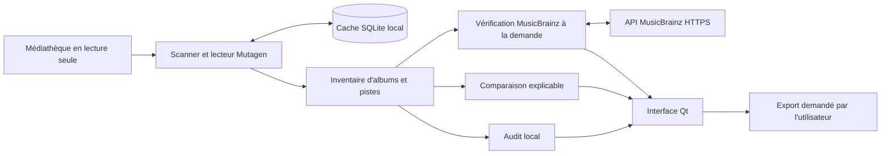

# Architecture de MusicScope

L'application sépare le moteur d'analyse de l'interface Qt. Le moteur et ses tests peuvent fonctionner sans session graphique ni réseau. Les services distants sont sollicités à la demande. Le rangement confirmé est séparé de tous les diagnostics en lecture seule.

## Modules et flux

| Module | Responsabilité |
| --- | --- |
| `models.py` | Pistes, albums et inventaire sérialisable ; conservation des tags et chemins d'origine. |
| `metadata.py` | Lecture Mutagen des formats natifs et correspondance des tags ID3, Vorbis et MP4. |
| `normalization.py` | Clés Unicode de comparaison, sans modification des valeurs affichées. |
| `scanner.py` | Découverte des fichiers, exclusion des liens, regroupement des disques et construction d'un inventaire. |
| `identity.py` | Vérification conservatrice du volume local et des identifiants physiques Linux ou Windows ; cache des points de montage par parcours. |
| `cache.py` | Cache SQLite des tags, hachages SHA-256 et derniers inventaires par racine. |
| `audit.py` | Champs manquants, incohérences et numérotation d'album suspecte. |
| `comparison.py` | Index des candidats, comparaison des albums et recherche exacte des fichiers. |
| `musicbrainz.py` | Transport HTTP limité, cache des réponses, évaluation des éditions et propositions de tags. |
| `gui.py` | Tableaux et filtres, tâches Qt en arrière-plan, comparaison côte à côte et présentation des constats. |
| `advanced_gui.py` | Menus et parcours Jellyfin, sources, qualité, décisions, sessions et rangement. |
| `jellyfin.py` | Catalogue GET paginé et traduction explicite des chemins serveur/poste. |
| `recognition.py`, `artwork.py`, `aliases.py` | Empreintes Chromaprint, AcoustID, pochettes et alias sourcés, déclenchés à la demande. |
| `review.py`, `session.py` | Décisions liées aux preuves, estimation prudente, coût SHA et sessions historiques versionnées. |
| `tagwriter.py`, `tag_editor_gui.py` | Écriture de tags confirmée : différences, journal SQLite des valeurs d'origine, relecture de contrôle et annulation ; dialogues de saisie et d'aperçu. |
| `organizer.py` | Plan de déplacement, renommage atomique sans remplacement, journal durable et restauration. |
| `selftest.py` | Autotest sans réseau du paquet source ou gelé. |
| `export.py` | Export CSV UTF-8 avec BOM, séparateur point-virgule et neutralisation des formules de tableur. |
| `demo.py` | Création explicite d'un corpus synthétique à partir des petits fichiers audio inclus. |
| `__main__.py` | Entrées graphique, génération de démonstration et scan JSON. |

## Inventaire et conservation

Un `Track` contient chemin, codec, taille, date de modification, durée, tags et identité physique lorsqu'elle est exploitable. Un `Album` conserve son dossier, ses pistes, un indicateur de lecture complète et ses constats. Un `Inventory` contient la racine, les albums, les erreurs et la date du scan.

Le regroupement est fondé sur les dossiers, et non sur l'égalité du tag Album. Les sous-dossiers de disques reconnus sont rattachés au parent. Un même dossier portant plusieurs identités d'album ou des numéros de disque contradictoires est signalé comme ambigu.

Le parcours ne suit pas les liens symboliques ni les jonctions. Les erreurs d'accès de parcours ou les modifications concurrentes détectées empêchent la sauvegarde du nouvel inventaire de référence. Les erreurs de lecture d'un fichier audio invalide sont enregistrées dans un album incomplet. La transaction de sauvegarde de l'inventaire est atomique ; les entrées de cache individuelles déjà lues peuvent être réutilisées lors d'un prochain essai.

Le scan se déroule en quatre temps. Les vérifications `stat` des fichiers découverts sont lancées en parallèle, puis le thread appelant consulte le cache SQLite. Les fichiers absents du cache ou modifiés sont lus en parallèle ; chaque résultat est enregistré dans le cache par le thread appelant dès qu'il arrive. L'inventaire est enfin assemblé dans l'ordre trié des chemins. Le résultat ne dépend donc pas de l'ordre d'achèvement des threads. Le nombre de threads est automatique : 1 sur un volume local reconnu, 8 sur un partage réseau ou un volume inconnu ; `--workers` le force. Une annulation abandonne les lectures non commencées et conserve en cache celles déjà terminées.

Après une analyse complète enregistrée, les entrées de tags et de hachages des fichiers qui ne sont plus présents sous la racine sont supprimées. Un scan annulé ou instable ne supprime rien.

Les entrées de pistes lues sont validées par lots de 256 pendant le scan, puis à la fin du parcours, y compris après une annulation ou une erreur. Un autre processus qui consulte le cache pendant un scan peut donc voir ces entrées avec un léger retard ; l'inventaire de référence reste enregistré en une seule transaction.

Le cache utilise le triplet chemin/taille/date de modification. Cette stratégie ne détecte pas une modification volontaire qui restituerait exactement la même taille et la même date. Les hachages sont lus en flux et vérifient la version du fichier avant et après lecture ; un fichier remplacé ou modifié pendant cette opération n'est pas accepté.

## Lecture seule et sorties

Les opérations de scan, comparaison et audit n'ouvrent pas les fichiers audio en écriture. Les écritures sont limitées au cache local et aux exports demandés. Le chemin du cache est refusé lorsqu'il se situe dans la racine musicale.

L'organisateur est la seule exception : après prévisualisation et confirmation explicite, il renomme le dossier entier sur le même volume. Un état d'intention est synchronisé sur disque avant le renommage. Le journal conserve les chemins et une empreinte de l'arbre ; la restauration vérifie qu'aucun contenu n'a changé et que l'ancien chemin est libre. Linux utilise `renameat2(RENAME_NOREPLACE)` avec des parents ouverts sans suivi de liens ; Windows utilise le renommage natif qui refuse une destination existante. Sous Windows les ancêtres sont revérifiés, sans garantie contre un acteur malveillant remplaçant simultanément un parent par une jonction.

Un fichier audio non présent dans l'inventaire de l'album, y compris un autre album imbriqué, bloque le plan. Le déplacement conserve les liens physiques ; leur présence requiert un accord distinct. Aucun transfert entre volumes, suppression ou écriture de tags n'est exécuté.

L'import JSON efface les identités physiques et conserve le caractère historique des preuves. Il ne restaure jamais des credentials ou une configuration distante et ne peuple pas le cache de scan avec des preuves anciennes.

La création de démonstration est une opération distincte, explicitement demandée avec `--demo`, qui écrit des fichiers synthétiques dans un dossier vide ou inexistant. Elle ne réutilise jamais une médiathèque existante comme destination non vide.

Les valeurs des tags sont considérées comme des données : elles sont échappées dans les présentations HTML et les valeurs pouvant être interprétées comme des formules sont neutralisées dans les exports CSV.

## Écriture de tags

L'éditeur de tags est la seule partie qui écrit dans les fichiers audio, avec la même interface de Mutagen pour les cinq formats (`easy` : Vorbis, EasyID3, EasyMP4) et huit champs : artiste d'album, album, date, genre, disque, numéro, titre, artiste. Pour chaque fichier :

1. la taille et la date doivent correspondre au dernier scan, sinon le fichier est refusé ;
2. les valeurs d'origine des champs modifiés sont validées dans `tags.sqlite3` avant l'écriture ;
3. les tags sont écrits, puis relus et comparés aux valeurs demandées ; en cas d'écart, les valeurs d'origine sont réécrites ;
4. l'état du fichier (`written`, `failed_restored`, `failed`) est enregistré.

Un fichier MP3 garde sa version ID3 : en ID3v2.3, plusieurs valeurs sont réunies dans un seul texte séparé par « ; ». Les autres tags du fichier ne sont pas modifiés. L'annulation compare les valeurs actuelles à celles écrites : elle ne restaure que les fichiers inchangés depuis, et refuse les autres. Aucune copie complète des fichiers n'est faite ; une coupure pendant l'écriture d'un fichier peut l'endommager, comme avec tout éditeur de tags.

## Comparaisons et niveau de preuve

Les candidats sont indexés par MBID d'édition, MBID de groupe d'éditions et clé artiste d'album/titre. Certaines mentions d'édition sont retirées de la seule clé de candidature ; les titres d'origine restent disponibles pour la comparaison et l'affichage.

Sous Linux, la table `/proc/self/mountinfo` est lue une fois par parcours au lieu d'une fois par fichier. La décision est mémorisée par dossier parent et périphérique (`st_dev`), avec la même règle qu'auparavant : le montage le plus profond contenant le chemin doit porter un seul type de système de fichiers local. Un périphérique non encore rencontré provoque une relecture de la table ; un montage ou un démontage pendant le scan n'est donc pas masqué par l'instantané. Un fichier qui est lui-même un point de montage est évalué sans mémoïsation. Sous Windows, le volume Win32 est mémorisé par dossier parent et numéro de série ; une sonde en échec n'est pas mémorisée. Cette partie Windows est testée par simulation uniquement.

L'identité physique n'est retenue que lorsque le scanner fournit une identité locale exploitable, puis que les fichiers correspondent encore à cette identité. Les montages locaux Linux reconnus et les volumes locaux NTFS/ReFS vérifiables sous Windows sont pris en charge. Les partages réseau et volumes non vérifiables restent indéterminés. Les sondes Win32 sont testées par simulation sous Linux ; leur exécution réelle sous Windows reste à valider. Un hash identique n'est pas assimilé à un lien physique.

La recherche exacte est indépendante des noms : tailles, puis SHA-256. La conclusion à l'échelle d'un album exige des inventaires complets et une correspondance bijective de toutes les pistes. Les comparaisons de métadonnées utilisent disques, numéros, titres, durées et identifiants disponibles. La tolérance de deux secondes ne constitue pas une reconnaissance acoustique.

## MusicBrainz

Une requête d'édition par MBID précède la recherche artiste/titre. Les candidats sont confrontés aux pistes locales ; le score de recherche du service ne suffit pas à sélectionner une édition. Les recherches de cette version examinent au plus cinq éditions et conservent un résultat indéterminé lorsque d'autres candidats peuvent subsister.

Le client utilise HTTPS avec vérification TLS, un User-Agent `MusicScope/0.1.0` accompagné de l'adresse du dépôt, un verrou de sérialisation et une limite d'une requête par seconde. Le cache SQLite est valable sept jours. Les erreurs temporaires autorisent au maximum trois tentatives avec attente ; une consigne serveur d'attente longue est remontée à l'utilisateur au lieu d'être contournée.

Les résultats distinguent une absence de résultat, une édition indéterminée et un service indisponible. Les propositions indiquent le fichier, le champ, la valeur actuelle, la valeur de référence, le motif et le lien de l'édition. Elles ne sont jamais écrites dans les fichiers.

## Interface et durée de vie

Les opérations longues sont exécutées dans un `QThread`. Chaque tâche crée et ferme ses propres connexions SQLite. Les signaux Qt transmettent progression, résultat ou erreur au fil de l'interface. Le scan et les calculs exacts possèdent une annulation coopérative ; une lecture réseau MusicBrainz attend sa fin ou son délai réseau.

Le dernier inventaire et la racine choisie peuvent être restaurés depuis le cache. Les tableaux de rapprochements recalculés, résultats de recherche exacte et propositions visibles sont des données de session ; le CSV sert à conserver ces constats avant une nouvelle analyse.

## Validation

Les tests ciblés isolent les règles de comparaison, simulent les réponses HTTP et exercent les scénarios d'accès interrompu. Les tests graphiques utilisent `QT_QPA_PLATFORM=offscreen` pour vérifier le parcours Qt sous Linux. Une validation sans écran ne remplace pas un essai sur un poste Windows ou un véritable partage NAS.
